# AutoReels

Upload one MP4 video and publish it to connected Instagram, TikTok, and YouTube accounts.

## Workflow

1. Upload an MP4 video.
2. Select connected accounts.
3. Send video to each platform API.
4. Track each platform result.

## Getting started

Run `npm run install:all`, copy `backend/.env.example` to `backend/.env`, set unique `JWT_SECRET`, `ENCRYPTION_KEY`, and `ADMIN_PASSWORD`, then run `npm run dev`. Connect platform accounts in the dashboard. Instagram requires a public HTTPS `PUBLIC_BASE_URL`; TikTok requires a developer app approved for `video.publish`; YouTube requires a token with `youtube.upload` scope.

## License

The project code is licensed under AGPL-3.0-only. See [LICENSE](LICENSE).
